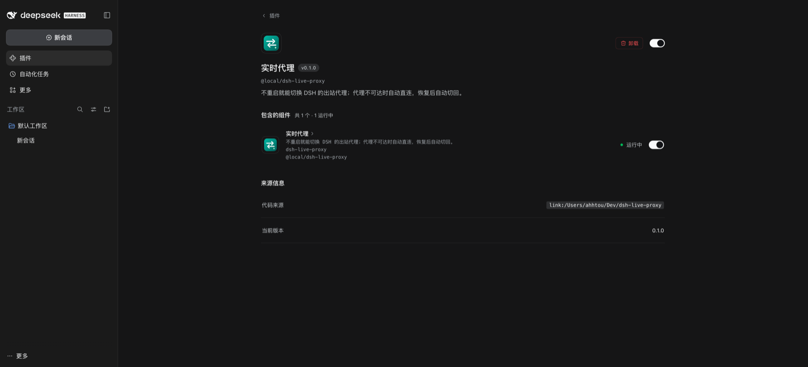
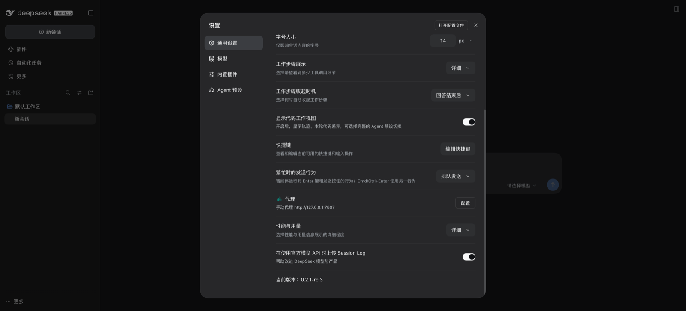
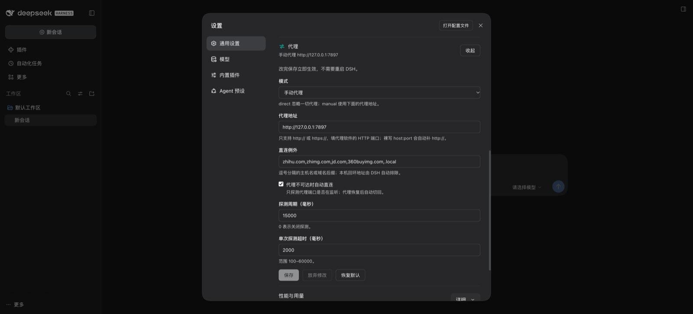

# DSH Live Proxy

在不重启 DeepSeek Harness 的前提下切换**进程级出站代理策略**，并在代理挂掉时自动回落直连、恢复后自动切回。

> DSH 启动时会把 `HTTPS_PROXY` / `HTTP_PROXY`（含 `~/.dsh/.env`）解析成一份进程级代理策略装进 `undici` 和 `web_fetch`，之后就再也不读了。改 `.env` 必须重启应用。
> 本插件复用官方同一条 seam（`@deepseek-ai/dsh-http-proxy` 的 `installProxyFromEnvironment`），把「改配置」变成「立即生效」：界面上一改，下一次出站请求就走新策略。

## 1. 它能做什么

- **热切换**：`direct` ⇄ `manual`，改完立即生效，不需要重启 DSH。
- **自动回落**：代理端口不再监听时切到直连，代理回来后自动切回（`fallbackToDirect`）。
- **界面可编辑**：所有配置字段都是 volatile，在 **设置 → 通用设置 → 代理**（或 **Plugins → 已安装插件 → 实时代理 → 配置**）里保存会写回 profile patch 并当场生效，不需要改 YAML、不需要重启。
- **不改 `.env`**：代理地址、直连例外、探测周期都在插件配置里；`.env` 可以在插件上线后清掉。

## 2. 安装

```sh
dsh plugin --profile desktop add /Users/ahhtou/Dev/dsh-live-proxy
```

**加载或更新插件代码需要重启一次 DSH**（浏览器半侧也要重新扫描一次）；装好之后，切换代理、改端口、开关回落都不再需要重启。

### 2.1 界面入口

**设置 → 通用设置 → 代理**（推荐）：

1. 点左下角 **更多 / 账号菜单** → **设置**（Settings）；
2. 左侧选择 **通用设置**，向下找到 **代理** 行（前面是青色的双向箭头图标）；
3. 点右侧 **配置** 展开 6 个字段，改完点 **保存**，立即生效；再点 **收起** 合上。

也可以从插件页进入：**Plugins → 已安装插件 → 实时代理 → 配置**。点开卡片后，点带箭头的「实时代理」行即可进入配置页。两个入口共用同一份表单和同一份配置，改任意一处另一处会同步。



| 设置 → 通用设置 → 代理 | 展开后的表单 |
|---|---|
|  |  |

> 为什么是「通用设置里的行」而不是左侧独立的「代理」页：Settings 的 `settings.section` 导航只为官方 section id 配图标，未知 id 会**强制回退成齿轮**（源码 `navIcon(id)`）。独立「代理」页会和「通用设置」共用同一个齿轮图标，所以这里改用 `settings.general.item` 行，行内自带青色的双向箭头图标。
>
> 这一版 DSH **不会**给第三方 bundle 自动生成配置界面：Settings 的 `settings.general.item` 和 Plugins 页的 `plugins.row.config` 都是扩展槽位，页面只提供表单数据（`state` + `mutate`），谁来渲染由插件自己的浏览器半侧决定。本插件的 `lib/client.js` 同时占用这两个槽位（行键 `@local/dsh-live-proxy#dsh-live-proxy`），所以仓库里同时有 Host 半侧 `index.js` 和 Client 半侧 `lib/client.js`。`package.json` 的 `dsh.client` 与 `exports["./client"]` 是加载 Client 半侧所必需的。

`cordis.patch.yml` 里的默认值是本机现状（Clash 系代理 `127.0.0.1:7897` + 原有直连例外）：

```yaml
- insert:
    - id: dsh-live-proxy
      name: '@local/dsh-live-proxy'
      config:
        mode: manual
        proxyUrl: http://127.0.0.1:7897
        noProxy: 'zhihu.com,zhimg.com,jd.com,360buyimg.com,.local'
        fallbackToDirect: true
        probeIntervalMs: 15000
        probeTimeoutMs: 2000
```

`package.json` 里的 `@deepseek-ai/dsh-http-proxy` / `@deepseek-ai/schemastery` peer 声明不是用来安装依赖的：DSH 的 loader 按 peer 名把裸导入路由到**运行中的安装副本**，同时按 dsh 版本做兼容性检查。

## 3. 配置项

| 字段 | 类型 | 默认 | 说明 |
|---|---|---|---|
| `mode` | `direct` \| `manual` | `direct` | `direct` 无视一切代理；`manual` 用 `proxyUrl` |
| `proxyUrl` | string | `http://127.0.0.1:7897` | 只接受 `http://` / `https://`；裸写 `host:port` 会自动补 `http://` |
| `noProxy` | string | `""` | 追加直连例外，逗号分隔；loopback 由 DSH 自动并入，无需填写 |
| `fallbackToDirect` | boolean | `true` | 探测失败时是否回落直连 |
| `probeIntervalMs` | number | `15000` | 探测周期；`0` 关闭探测 |
| `probeTimeoutMs` | number | `2000` | 单次 TCP 探测超时 |

`mode` 的默认值是 `direct`：装了插件但不配置，行为与不装一致。

## 4. 工作原理

1. **切换**：每个新策略都通过 `installProxyFromEnvironment(envMap, report)` 重新安装一次。它先被串行化——旧 disposer 必须 `await` 完成，再装新的；两条策略相同则直接跳过，避免叠加安装导致 dispatcher 泄漏。
2. **为什么必须走这条 seam**：`web_fetch` 不走全局 `undici` dispatcher，而是每次请求读 `proxyRouteFor(url)` 的返回值。只 `setGlobalDispatcher()` 的插件修不了 `web_fetch`。
3. **热更新**：配置字段全部 `.volatile()`。界面保存后 Loader 只更新 fiber 的引用并发出 `loader/volatile-update`，插件监听该事件重读配置、重新 `apply` 策略。
4. **探测**：对 `proxyUrl` 的 host:port 做 TCP connect。它只回答「代理进程还在不在监听」，不代表上游一定通——这是本插件刻意的边界：不向任何第三方地址发请求，也不引入额外延迟。
5. **卸载/停用**：disposer 把 launcher 原本安装的策略（通常来自 `.env`）恢复回去。
6. **两个界面入口**：`lib/client.js` 把同一个表单注册到 `settings.general.item`（设置 → 通用设置 → 代理）和 `plugins.row.config`（Plugins 行配置）。两处都通过 Host 的 `form.mutate(ops, revision)` 写同一份配置；保存后走上面第 3 条的热更新链路，所以不需要重启。

## 5. 验证

```sh
# 单元测试
node --test test/*.test.js

# 代理端口是否在听
nc -z 127.0.0.1 7897

# 真实抓取（改配置后应立即生效，无需重启）
# 会话里让 agent 执行 web_fetch https://www.google.com
```

切换时 DSH 日志里会出现类似：

```text
dsh-live-proxy: outbound route -> proxy http://127.0.0.1:7897 (bypass: zhihu.com,...)
dsh-live-proxy: proxy http://127.0.0.1:7897 is unreachable (connect ECONNREFUSED ...); using a direct connection until it returns
dsh-live-proxy: outbound route -> direct (fallback: proxy unreachable)
```

## 6. 已知限制

- **SOCKS 不支持**：`installProxyFromEnvironment` 只接受 `http:` / `https:`，`socks5://` 会被拒绝并让该 scheme 直连。请填代理软件的 HTTP 端口。
- **探测只看端口**：代理在跑但上游断网时不会触发回落（这是有意的：探测不对外发请求）。
- **worker / telemetry 不受影响**：`workflow` 引擎和 ptc-runtime 的 worker 被官方刻意排除（怕代理 URL 里的密码泄漏给模型脚本），OTLP 遥测也直连。插件沿用同样的边界。
- **子进程**：由 DSH 的 `proxyEnvironmentForChild()` 统一处理，插件不需要也不应该自己改子进程环境。
- **`system` 模式还没做**：macOS 的 `scutil --proxy` 读取在第二步。

## 7. 路线图

- `mode: system`：macOS 读 `scutil --proxy`，跟随系统代理开关。
- 会话头部的一键开关与当前路由显示（client 端）。
- 按用途分流：模型请求直连 / `web_fetch` 走代理（参考 `dsh-egress-router`）。
- 发布：仓库加 `dsh-plugin` topic，包名从 `@local/dsh-live-proxy` 改为 `dsh-live-proxy`。

## 8. 参考

- DSH《在网络代理后面运行》<https://deepseek-harness.github.io/deepseek-harness/guide/network-proxy>
- `@deepseek-ai/dsh-http-proxy` 源码：`app.asar/dsh/node_modules/@deepseek-ai/dsh-http-proxy/lib/index.js`
- 社区实现：[dsh-egress-router](https://github.com/fengyevvv/dsh-egress-router)、[dsh-proxy-pro](https://github.com/yanglaofish/dsh-proxy-pro)、[dsh-provider-proxy](https://github.com/apolenkov/dsh-provider-proxy)

## 9. 开发约定

提交信息末尾必须带 `Agent:` / `Model:` 两行 trailer，见 [AGENTS.md](AGENTS.md)。设计背景与踩坑记录见 [HANDOFF.md](HANDOFF.md)。
